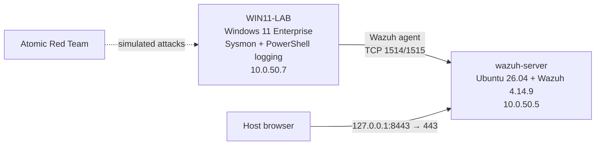

# SIEM Alert Triage Lab

A home SOC lab built to practise the core of a Tier 1 analyst's job: triaging alerts and deciding what to close, what to tune and what to escalate. I built a Wazuh SIEM, connected a Windows 11 endpoint running Sysmon, simulated attacker techniques with Atomic Red Team, and then investigated the alerts as if I didn't know what caused them.

## Results

| # | Alert | Verdict | Action | Write-up |
| --- | --- | --- | --- | --- |
| 1 | New local account created and added to Administrators | **True positive** | Escalated | [01-admin-account-created](triage/01-admin-account-created.md) |
| 2 | Local account and group discovery | **Benign true positive** | Closed | [02-account-discovery](triage/02-account-discovery.md) |
| 3 | PowerShell created an executable in a Windows folder | **False positive** | Tuning rule proposed | [03-psscriptpolicytest-false-positive](triage/03-psscriptpolicytest-false-positive.md) |

Escalation note for alert 1: [escalation-note](escalation/escalation-note.md)

## Architecture

Both VMs run in VirtualBox on an isolated NAT Network (`10.0.50.0/24`). Full build details are in [lab-setup.md](lab-setup.md).

## Tools

- **SIEM:** Wazuh 4.14.9 (manager, indexer, dashboard) on Ubuntu Server 26.04
- **Endpoint telemetry:** Sysmon with the SwiftOnSecurity config, PowerShell script block (4104) and module logging, Windows Security log
- **Attack simulation:** Invoke-AtomicRedTeam (T1087.001, T1136.001, T1053.005)
- **Framework:** MITRE ATT&CK

## Key findings

- **Correlation across log sources.** The Sysmon process event and the Security log group change shared logon ID `0x4a525`, which tied account creation and a later scheduled task to one session.
- **Severity isn't risk.** Real attacker discovery activity only scored level 3, while the test framework's own PowerShell scored level 12.
- **Noise from normal Windows behaviour.** PowerShell's `__PSScriptPolicyTest_` files triggered a level 9 alert. I wrote a narrow tuning rule rather than disabling the whole rule.
- **Detection gap.** Creating a scheduled task only produced a generic level 3 alert, because task-creation auditing (event 4698) is off by default.
- **Credentials in logs.** Command-line logging captured a cleartext password from `net user /add`, so these logs need access controls.

## What I'd do next

- Enable "Audit Other Object Access Events" and re-test scheduled task detection (event 4698)
- Write a Sigma rule for `schtasks /create` from unusual parent processes (Project 5)
- Investigate the recurring `61618` svchost.exe alerts as a second tuning candidate

## Lab-only choices

These were deliberate for an isolated lab and would not be done in production:

- Defender exclusion on `C:\AtomicRedTeam` and real-time protection briefly disabled to install the tooling
- PowerShell execution policy set to Bypass for the lab user

## Part of my SOC portfolio

1. **SIEM Alert Triage Lab** (this repo)
2. Phishing Email Investigation (coming soon)
3. Decoding Malicious PowerShell (coming soon)
4. Malware Sandbox Report (coming soon)
5. Sigma Detection Rule (coming soon)
