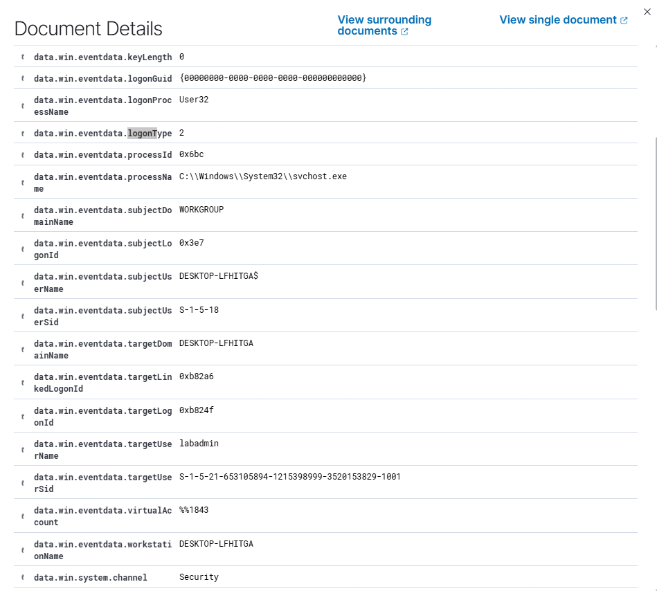
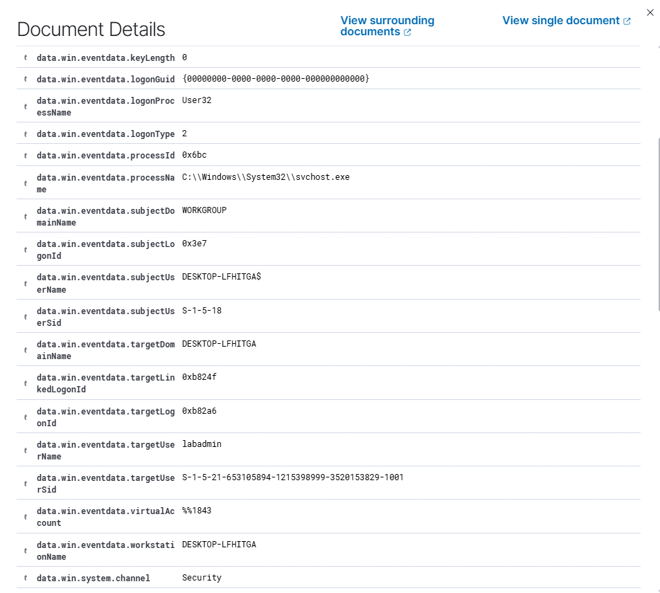
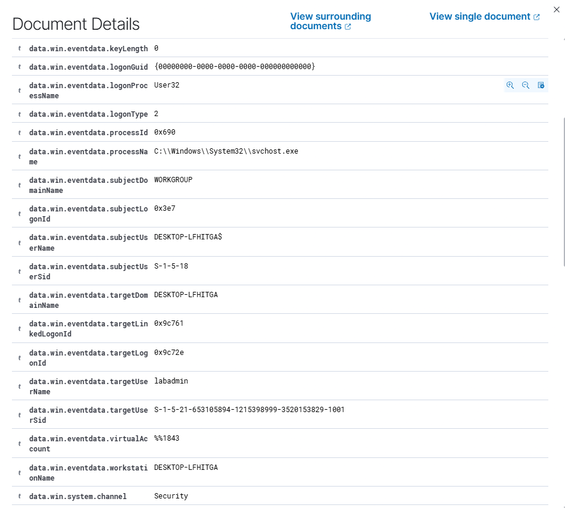
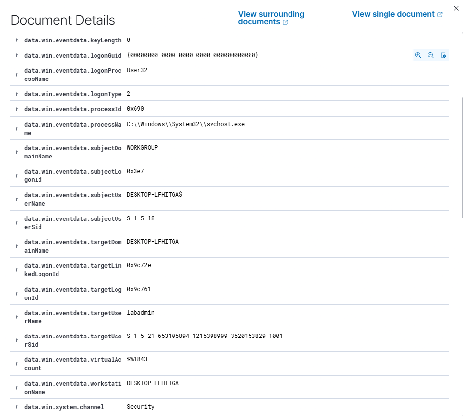

# Escalation: Unauthorised local admin account and persistence on DESKTOP-LFHITGA

**Severity:** High
**Raised:** 31 Oct 2026, AEDT
**Analyst:** Dylan Mitchell
**Related triage:** `triage/01-admin-account-created.md`

## Summary

At 20:28 AEDT on 31 Oct 2026, a process running as `labadmin` on DESKTOP-LFHITGA created a new local account, `T1136.001_Admin`, and added it to the Administrators group. Fifteen minutes later, the same logon session created a scheduled task named `spawn` that launches `cmd.exe`.

## Affected

- **Host:** DESKTOP-LFHITGA (Wazuh agent WIN11-LAB, 10.0.50.7)
- **Accounts:** `labadmin` (actor), `T1136.001_Admin` (new admin account, SID ending -1002)

## Evidence

- **20:28:43:** `net1 user /add "T1136.001_Admin" "T1136_pass"` ran with high integrity from `C:\Users\labadmin\AppData\Local\Temp\` (Sysmon event 1, Wazuh rule 92040).
- **20:28:47:** the new account was added to Administrators (Security event 4732, rule 60154). It shares logon ID `0x4a525` with the process above.
- **20:43:** `schtasks /Create /SC ONCE /TN spawn /TR cmd.exe` ran in the same session (rule 92032).
- **Logon review:** `labadmin` logged on at the console (event 4624, logon type 2) at 20:15 and 20:25 on 31 Oct, with logon IDs `0xb82a6`/`0xb824f` and `0x9c761`/`0x9c72e`. Neither matches `0x4a525`, and no 4624 for `0x4a525` exists in the SIEM over the last 7 days.
- **New account use:** no logons by `T1136.001_Admin` were found.

## Assessment

This is likely malicious. An attacker with admin access, or a compromised `labadmin` account, has created a backup admin account and a scheduled task. Both let them keep access even if `labadmin`'s password is reset. There is no change ticket for either action.

## Actions taken

None. Analysis only.

## Recommended actions

1. Isolate DESKTOP-LFHITGA from the network.
2. Disable `T1136.001_Admin`, delete the `spawn` scheduled task, and keep copies of both as evidence.
3. Reset the `labadmin` password and review its recent logons (event 4624) for unusual sources or times.
4. Search other endpoints for the same account name, task name, or `net user /add` activity.
5. Pull 4624 events directly from the endpoint's Security log to find how session `0x4a525` started.

## Open questions

- The originating logon for session `0x4a525` is not in the SIEM. Wazuh only stores 4624 events that match its rules, so the logon may never have been forwarded. Until it's found, we can't tell whether the session was local, RDP, or a remote tool.
