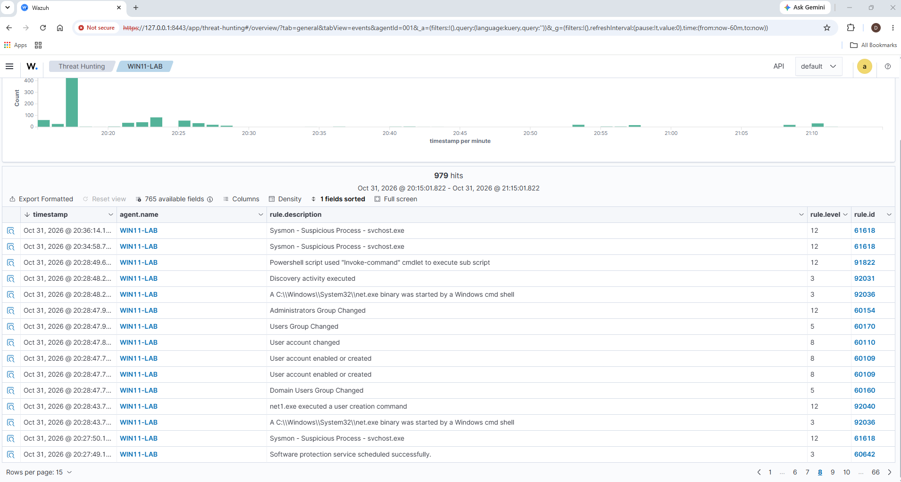
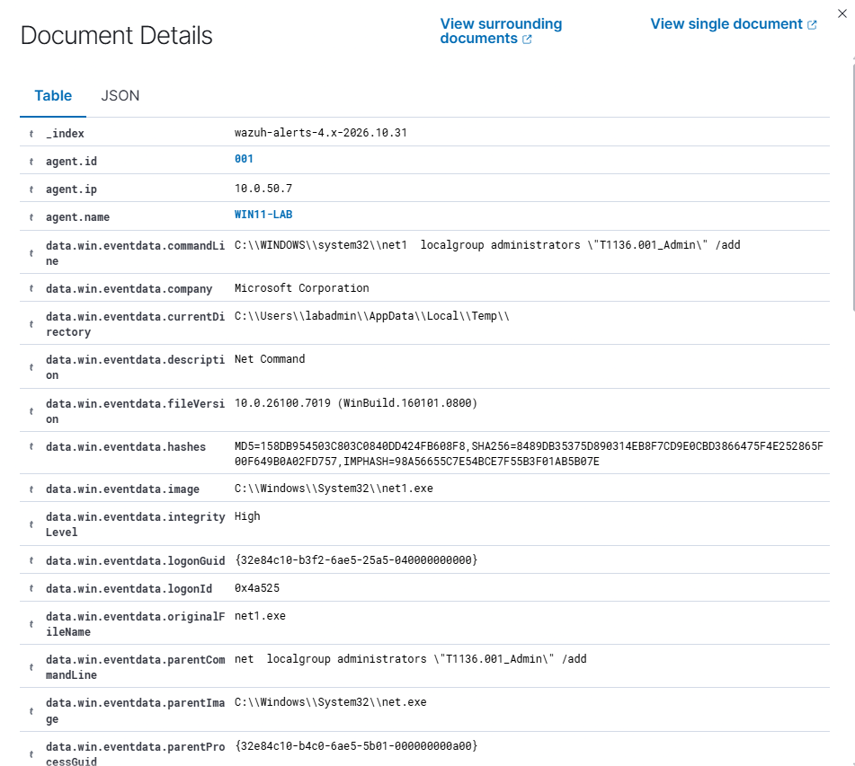

# Alert: Local account and group discovery

**Rules:** 92031 (level 3), 92036 (level 3), 92032 (level 3); related 91822 (level 12)
**Time:** 30 Oct 2026, 11:59:28–11:59:34 AEDT (00:59 UTC)
**Host:** DESKTOP-LFHITGA (Wazuh agent WIN11-LAB, 10.0.50.7)
**User:** labadmin
**MITRE ATT&CK:** T1087.001 Account Discovery: Local Account, T1069.001 Permission Groups Discovery: Local Groups

## What fired

A command shell ran a burst of discovery commands that listed local users, user profiles, saved credentials and local groups. Wazuh raised several level 3 alerts.

## Investigation

**Commands observed**

| Command | Purpose |
| --- | --- |
| `net user` | List local accounts |
| `dir C:\Users` | List user profile folders |
| `cmdkey /list` | List saved credentials |
| `net localgroup "Users"` / `net localgroup` | List groups and members |

- **Process chain:** `cmd.exe` → `net.exe` → `net1.exe` (rule 92036)
- **Related level 12 alert (91822):** PowerShell used `Invoke-Command` to run a sub-script one second later. That came from the PowerShell framework that launched the commands, not from the discovery itself.

**Context checked**

- [x] Follow-on activity within ±15 minutes: no account creation, persistence or outbound connections seen
- [x] Is labadmin an administrator who would run these commands? Yes, it's the machine's admin account
- [x] Do the commands change anything? No, they're all read-only

## Verdict

**Benign true positive.** The activity really happened and the rules fired correctly, but it matches normal admin behaviour: read-only commands, run by the machine's own admin account, with no follow-on activity. The one command worth a second look is `cmdkey /list`, because attackers use it to find saved credentials. In a production environment, I'd confirm with the user before closing.

## Action

**Closed, no escalation.**

## Lessons

- The real discovery activity only reached level 3, while the tooling around it hit level 12. Severity reflects the rule, not the actual risk.
- Discovery on its own is weak evidence. It matters when it comes before something else, like account creation or lateral movement.

## Evidence

